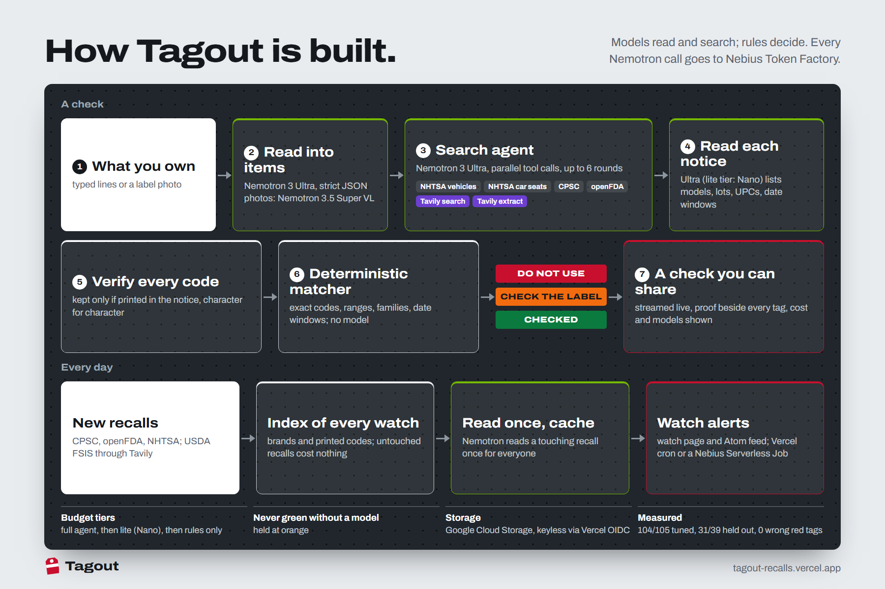
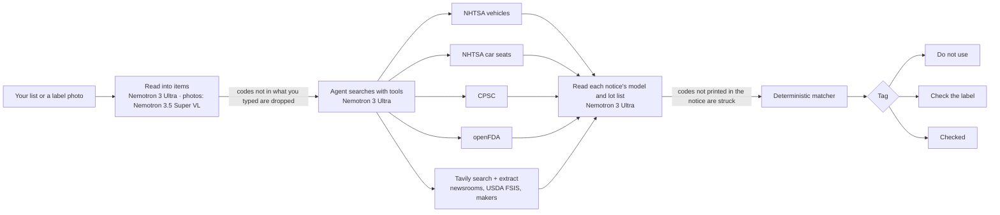
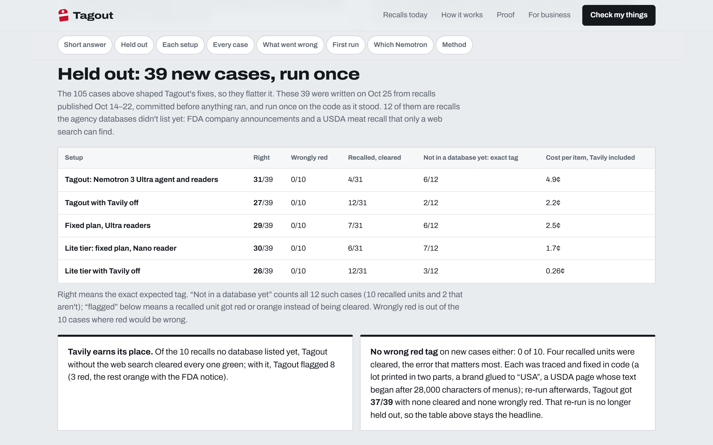
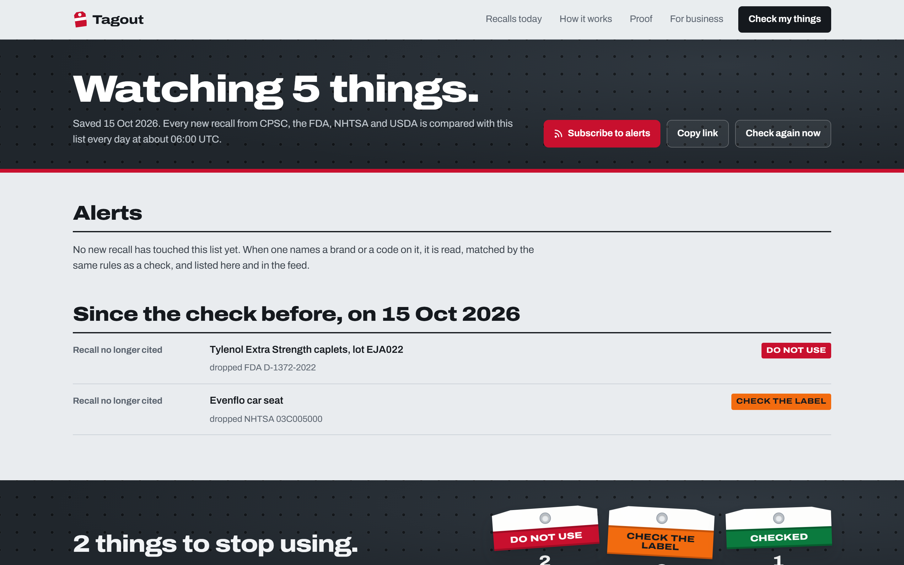

<div align="center">


<br>

[](https://github.com/RohanGlitched/tagout/actions/workflows/ci.yml)
[](#how-nemotron-and-nebius-token-factory-are-used)
[](#how-tavily-is-used)
[](#held-out-39-new-cases-run-once)
[](#data-sources)
[](LICENSE)

**[Try it live](https://tagout-recalls.vercel.app)** · **[A finished check](https://tagout-recalls.vercel.app/check/kj6iutme8c)** · **[The eval](https://tagout-recalls.vercel.app/proof)** · **[Held out](https://tagout-recalls.vercel.app/proof#held-h)** · **[A watched household](https://tagout-recalls.vercel.app/watch/5ehharz7sr)** · **[Alerts, replayed](https://tagout-recalls.vercel.app/watch/replay1013)** · **[Caught on the web](https://tagout-recalls.vercel.app/check/vbywum2ru4)** · **[How it works](https://tagout-recalls.vercel.app/how)**

**Demo video:** https://youtu.be/_nQDZehK33w (2:43)

</div>

---

**On three held-out sets it had never seen, each run once (39 cases, then 19 and 8 pre-registered with public git tags), Tagout got 50 of 66 right, flagged 42 of 46 recalled items, and raised 3 false alarms, all published with their causes. Tavily was the difference on recalls no database listed yet: with it off, all 10 in the first set were cleared green; with it on, 8 were flagged. On the 105 cases it was tuned on, it now tags all 46 recalled units Do not use with no false alarm; NVIDIA Nemotron 3 Ultra on its own caught 5 of the 46.**

Tagout checks what a household owns against live U.S. recalls. List what you own, or photograph the label. An agent on **NVIDIA Nemotron** (served by **Nebius Token Factory**) searches NHTSA, CPSC and the FDA with tools, and **Tavily** searches the agencies' newsrooms and USDA for anything the databases don't have yet. Nemotron reads each notice's list of affected models and lots, every code is checked against the notice's own text, and plain rules hang the tag. Save the list as a watch and a daily sweep reads every new recall once and matches it against the list; the watch's Atom feed tells you when one covers something you own.

## Try it in one minute

1. Open https://tagout-recalls.vercel.app. No account, nothing to install.
2. Tap **A space heater** and **A medicine**, then **Check my things**.
3. Watch the agent search CPSC, the FDA and the web (about 25 seconds an item). Then the tags are hung: the Vornado heater (`TYPE SRTH`) and Tylenol lot `EJA022` are both **Do not use**, each with the recall's own line next to yours.
4. Try a car (`2019 Honda CR-V`) or a car seat with no model number (`Evenflo car seat`): both are **Check the label**, and the tag says exactly what to look up.
5. At the bottom of a finished check, **Watch these things** saves the list. [This watch](https://tagout-recalls.vercel.app/watch/5ehharz7sr) started from the Oct 8 showcase; the daily sweep checks it against every new recall, and [its feed](https://tagout-recalls.vercel.app/watch/5ehharz7sr/feed.xml) works in any feed reader.
6. The [eval](https://tagout-recalls.vercel.app/proof) shows every case and every answer, including the ones that were wrong.
7. [This check](https://tagout-recalls.vercel.app/check/vbywum2ru4) shows two recalls only the web search could find, each marked on its tag.

Every check gets its own link, so you can send it to someone.

## Why

CPSC alone recalled 498 products in 2026 by Oct 29 (its database, by recall date; the home page wall also counts the newest newsroom postings), covering more than 50 million units by its own count; the FDA, NHTSA and USDA add thousands more. Each sits in its own database, in its own words, and the deciding detail (a model number, a lot, a date window) is usually buried in a paragraph. CPSC's own staff measured what that costs: recalls announced only by press release got **6%** of consumers to act, while recalls sent straight to owners got **50%** ([CPSC Recall Effectiveness Workshop, recall data, closed cases FY2013–2016](https://www.slideshare.net/slideshow/cpsc-recall-effectiveness-workshop-recall-data/78744492)). Tagout takes the list of things a household actually owns, does the looking, and keeps looking.

## Held out: 39 new cases, run once

The 105 cases shaped the fixes above, so on Oct 25 we wrote 39 new cases from recalls published Oct 14–22, committed them (`eval/cases-holdout.json`, commit `d9dce10`) before anything ran, and ran each setup once. Twelve are recalls no agency database listed yet: FDA company announcements and a USDA FSIS recall that only a web search can find. Full write-up: [`eval/HOLDOUT.md`](eval/HOLDOUT.md).

| Arm | Right | Wrongly red | Recalled, cleared | Not in a database yet | Cost per item, Tavily included |
|---|---|---|---|---|---|
| **Tagout** | **31/39** | **0/10** | 4/31 | 6/12 | 4.9¢ |
| Tagout, Tavily off | 27/39 | 0/10 | 12/31 | 2/12 | 2.2¢ |
| Fixed plan, Ultra readers | 29/39 | 0/10 | 7/31 | 6/12 | 2.5¢ |
| Lite tier (fixed plan, Nano reader) | 30/39 | 0/10 | 6/31 | 7/12 | 1.7¢ |
| Lite tier, Tavily off | 26/39 | 0/10 | 12/31 | 3/12 | 0.26¢ |

- **Tavily, measured.** With Tavily off, Tagout cleared all 10 recalled units that no database listed yet; with it, it flagged 8. On the 27 database cases Tavily changed nothing.
- **The misses.** Four recalled units were cleared: a two-part lot code (`091026 DL`), a whole-line air-rifle recall dropped before the tag, and two USDA FSIS lines. Each was traced and fixed afterwards (commits `9677671`..`a9a0f8f`, tests in `test/holdout-fixes.test.ts`). Re-run after the fixes, Tagout gets **37/39 with none cleared and none wrongly red**, and 105/105 on the tuned set; that re-run is no longer held out, so the table above stays the headline (`eval/holdout-after-fixes.json`).

Reproduce it. Every HTTP response is cached: with the scrubbed archive [`eval-cache.tgz`](https://github.com/RohanGlitched/tagout/releases/download/eval-2026-10-25/eval-cache.tgz) (5.2 MB, release `eval-2026-10-25`; unpacks as `eval/.cache/` in the repo root), `npm run eval:replay` reads the same data and costs nothing. Without the archive:

```bash
node eval/verify.mjs                                          # ground truth against the agencies
npx tsx --conditions=react-server eval/run.ts tagout          # one arm; also alone-ultra, search-ultra, fixed-plan-nano, rules, ...
node eval/score.mjs                                           # eval/summary.json and the table above
node eval/spend.mjs                                           # what the eval spent on Token Factory
```

The whole eval, including the runs thrown away while the harness was fixed, cost $4.66 of Token Factory tokens.

## Held out #2: 19 cases, pre-registered in public

Built on Oct 25 to measure what the first sets never had on a recalled unit: a serial inside a printed range, a prefix-and-number family, best-by and use-by windows, and near misses in the gap of a listed run of codes. The cases and their ground truth were pushed with the git tag [`prereg-2026-10-25`](https://github.com/RohanGlitched/tagout/releases/tag/prereg-2026-10-25) (commit `45dc3a1`, sha256 `34907813bf703a3d…`) before any run, and run once on Oct 30 (IST) at `889b9b0`; the only `lib/` change since the tag is `lib/site.ts` (the video link and showcase ids, no logic: `git diff prereg-2026-10-25 889b9b0 -- lib`). Results, unedited and with both run logs: [`eval/results-holdout2/`](eval/results-holdout2), [`eval/holdout2-summary.json`](eval/holdout2-summary.json), write-up in [`eval/HOLDOUT.md`](eval/HOLDOUT.md#held-out-2-pre-registered-in-public).

| Arm | Right | Wrongly red | Recalled, cleared | Recalled units red | Cost per item, Tavily included |
|---|---|---|---|---|---|
| **Tagout** | **15/19** | **1/9** | **0/11** | 6/8 | 4.7¢ |
| Lite tier (fixed plan, Nano reader) | 13/19 | 2/9 | 1/11 | 4/8 | 1.4¢ |
| No model at all (added afterwards, not pre-registered) | 10/19 | 1/9 | 0/11 | 1/8 | 0.9¢ (Tavily only) |
| Tagout with Tavily off (added afterwards, not pre-registered; same code, in a worktree) | 14/19 | 1/9 | **2/11** | 5/8 | 2.3¢ (no Tavily) |

- **The one wrong red (g07):** a pizza whose UPC is in openFDA's record of the recall, with a best-by date (06/20/2027) outside the recall's window (through 3/30/2027). The matcher checks a made-date window for codes a reader lists, not for a UPC taken from the record's own list.
- **Ranges and families:** the unit inside the printed serial range and the one inside the code family both came out orange, not red: the safe miss. All 7 of Tagout's reds were exact matches.
- **What Nemotron adds, held out and at the same code:** 15/19 against 10/19 for rules alone (+5); 6 recalled units red against 1.
- **Gaps:** 4 of 4 right; no gap was read as inside a range. **Recalls in no database:** 3 of 3 right, all from pages only Tavily reached (the Pan Pepin lot red, its neighbouring lot green, the sprats advisory orange).
- **Tavily off, same code (added afterwards):** the 2 recalls no database had went from 2/2 flagged to 0/2 (g15, g16 cleared green); recalled items cleared green 0 of 11 with Tavily, 2 of 11 without; 15/19 against 14/19 overall (g19 was right only without the web, because the keyless waits that timed it out never happened).
- **Fixed since, in-sample:** a best-by or use-by window printed in the record's own text is compared with the date on the line (g07), and codes a notice bounds instead of listing are read from its text: a two-group serial inside a printed from-to pair (g01) and a prefix followed by a number in a printed range (g03). Replayed offline, g01 and g03 turn red, g04 green and g07 orange, and nothing moves on the 105 or held out #1. g19 was a harness artifact: the app never waits on Tavily's keyless limit (`test/tavily-429.test.ts`), the harness now caps its wait at 30 s, and g19 re-run that way is Checked. [Details](eval/HOLDOUT.md#after-held-out-2-oct-30-in-sample-written-after-reading-the-misses-above).
- **As run:** Tavily was in keyless mode for both arms (the month's credits were spent: 0 credits used), and its hourly cap pushed one Tagout check, the clean item g19, past its deadline, so it was held orange. Token Factory spend: $0.51.

## Results: 105 tuned cases (in-sample)

Cases come from 2025–26 CPSC recalls, openFDA enforcement reports and NHTSA's recall API: 46 units whose code is printed in a recall, 27 near misses (a neighbouring lot or model, a date outside the window), 12 recalled product lines with no code given, 12 cars and 8 things no recall lists. [`eval/verify.mjs`](eval/verify.mjs) checks every expected answer against the agency's own record without any Tagout code. All 105 verify.

At today's code (`acc0639`, Oct 30), confirmed by an offline replay of every recorded arm (`eval/replay-summary.json`); the live arms ran Oct 24-25 (Tagout and the lite tier at `ed2dc77`, the others at `a9a0f8f`; `eval/summary-current.json`). These cases shaped the fixes, so they are in-sample; the held-out sets above are the fairer estimate.

| Arm | Right | Wrongly told to stop using | Recalled, but cleared | Red tags right | Recalled units caught | Cost per item, Nemotron | With Tavily |
|---|---|---|---|---|---|---|---|
| **Tagout** (Ultra reads the list, runs the agent, reads the notices; rules decide) | **105/105** | **0** | **0** | 100% (46/46) | 100% (46/46) | 2.6¢ | 4.4¢ |
| Nemotron 3 Ultra reading Tavily's results, no rules | 75/105 | 5 | 12 | 85% (29/34) | 63% (29/46) | 0.32¢ | 1.1¢ |
| Nemotron 3 Ultra alone, no tools | 45/105 | 5 | 36 | 50% (5/10) | 11% (5/46) | 0.26¢ | 0.26¢ |
| Fixed search plan, Nano reads the notices (the lite tier) | 101/105 | 1 | 0 | 98% (46/47) | 100% (46/46) | 0.23¢ | 1.4¢ |
| No model at all (fixed plan, pattern reader, rules; never green) | 83/105 | 2 | 0 | 95% (37/39) | 80% (37/46) | 0¢ | 1.1¢ |

On Oct 15 the same cases gave Tagout 104/105, the lite tier 98/105 and rules alone 87/105 (10 recalled units cleared). Rules fell to 83 once a tag could no longer be green without a model: its 10 cleared recalls turned orange, and so did 7 clean things.

- **Nemotron alone invents recalls.** All five of its wrong red tags cite a recall number and a reason, such as "CPSC 23-231, Model 53101-209 is explicitly listed" for a ZWILLING kettle that recall doesn't list. Tagout's rules can't do that: red needs your code printed in the notice.
- **The first run was worse, and it says so.** The first full run got 98 of 105: 2 units wrongly red and 2 recalled units cleared. Each miss was traced and fixed in code with a unit test (a lot list cut short at its first group, a date code, a one-sided date window, an FDA page replacing a record's text, a brand field openFDA leaves empty, a trailing X read as a wildcard). One expected answer was wrong and was corrected: a Jan 2026 recall covers all lots of one distributor's Claritin. The numbers above are measured on cases that shaped those fixes; the first run is the fairer estimate for new ones. Both are on [/proof](https://tagout-recalls.vercel.app/proof).
- **Where the agent earns its place.** With the same rules, the fixed search plan is nearly as safe on red tags but sends more needless "check the label" tags on things nobody recalled (5 of 8 right vs 8 of 8 at today's code), and costs about a tenth of the full check's Nemotron (0.23¢ against 2.6¢) and about a third all in (1.4¢ against 4.4¢). So it became the fallback, not the default.
- **Limits.** One run per arm, not an average. We picked the cases. Recalled units come from notices that print a code; a recall that prints none can only ever be orange.

## What happens in a check





1. **Read.** Nemotron turns each line into a kind of product, a brand and the codes a recall turns on (model, lot, VIN, UPC, NDC). Each code it returns must appear in what the person typed or it is dropped. VINs are decoded with NHTSA's vPIC. Label photos are read by NVIDIA Nemotron 3.5 Super VL on Token Factory (7 of 7 codes on two made-up sample labels; on CPSC's real price-tag photo, held-out h07, it ran out of its 2,500-token budget and the Qwen3.8 27B fallback read it; with 6,000 tokens it reads it, in-sample), with Qwen3.8 27B and Gemma 3 27B as fallbacks.
2. **Search.** Nemotron 3 Ultra runs an agent loop with six tools: NHTSA vehicle recalls, NHTSA child-seat recalls, CPSC (SaferProducts.gov), openFDA enforcement reports, Tavily search and Tavily extract. It reads results and searches again with better words (CPSC files a space heater under "tower heaters"). It always runs a Tavily search too, because the databases trail the agencies' newsrooms by one to six weeks, and USDA FSIS is only reachable through the web. A few rules keep recalls the model may not drop: any notice containing the item's own code, a brand's car-seat campaigns, and a brand's FDA recalls of the product when no lot was given.
3. **Read the notices.** CPSC prints model numbers only in prose ("The model 'TYPE SRTH' is printed on the silver rating label"). Nemotron reads the affected models, lots, UPCs and date windows from each notice. Every code is then looked up in the notice's text, as whole words and outside any "not included" sentence (8 fixture tests in `test/verify-codes.test.ts`); anything not printed there is struck, and the check says so.
4. **Match.** [`lib/match.ts`](lib/match.ts) compares the household's codes with each list, without a model: exact codes, printed ranges (`2LC1234 through 2LC1240`), family codes (`5160X`, in model lists only), TYPE codes and manufacture-date windows, open at one end or both. When the reader's list missed a code that the notice's own text prints, the text wins. A near miss (`CT22425` vs `CT22425B`), or a model match when the recall is limited to date codes that yours isn't, is orange, never red. Cars are orange at most: NHTSA has no public per-VIN API, so the tag links to its VIN lookup.

The tags follow industrial lockout/tagout colours:

| Tag | Meaning |
|---|---|
| 🟥 **Do not use** | A code printed on your product is on the recall's list. Remedy and contact shown. |
| 🟧 **Check the label** | The product line is recalled; yours isn't confirmed either way. The tag says where the code is printed. |
| 🟩 **Checked** | No recall lists it on the day of the check; the sources searched are named. |

## How Nemotron and Nebius Token Factory are used

All model calls go to **Nebius Token Factory**'s OpenAI-compatible API (`https://api.tokenfactory.nebius.com/v1`) from [`lib/nebius.ts`](lib/nebius.ts).

| Role | Model | How | Measured alternative |
|---|---|---|---|
| Read the household's list | `nvidia/Nemotron-3-Ultra-550b-a55b` | Strict `json_schema`; every code verified against the input | Super filed 11 of 105 eye drops and foods as products (the wrong database); Nano dropped a car's year |
| Search agent | `nvidia/Nemotron-3-Ultra-550b-a55b` | OpenAI-style `tools`, parallel tool calls, up to six model turns (the prompt asks for at most four rounds of searching), `finish` forced on the sixth | On 18 cases, Super was right on 17 at half the cost and Nano on 15: too few to move the agent |
| Read each recall notice | `nvidia/Nemotron-3-Ultra-550b-a55b` | Strict `json_schema`; codes verified against the notice text | Oct 15 run: Super 1 unit wrongly red, Nano 2 |
| Lite tier notice reader | `nvidia/NVIDIA-Nemotron-3-Nano-30B-A3B`, reasoning off (`enable_thinking: false`), retried with reasoning on if a reply is cut off | With the fixed search plan, once the day's Ultra budget is spent | 101 of 105 at current code (98 on Oct 15) right, none cleared, 0.23¢ of Nemotron an item, 1.4¢ all in |
| Fallback for every role | `nvidia/nemotron-3-super-120b-a12b` | Same calls; used when the first model errors or times out | |
| Read label photos | `nvidia/Nemotron-3.5-Super-VL`, then `Qwen/Qwen3.8-27B`, then `google/gemma-3-27b-it` | Vision chat with `json_schema` | All three read 7 of 7 codes on two made-up sample labels; on the real Primark tag photo (h07) Super VL ran out of budget and Qwen read it |

The track says to reach for Nemotron 3 Ultra for serious reasoning and let Nano or Super handle the fast, everyday calls. Measured: Ultra keeps the list reader and the agent (Nano dropped a car's year; Super filed medicines as products, the wrong database); Nano reads the notices in the lite tier (101/105 at 0.23¢); Super VL reads plates; the daily sweep reads each new recall once. On unseen data, held out #2's seven Tagout reds came 2 from the reader's list, 3 from the record's own list and 2 from the notice text, and the same code with no model got 10/19 against Tagout's 15/19. The agent's edge over the fixed plan is small (31 vs 30 and 15 vs 13 held out); only the agent got h07, h43, g06 and g14. We measured each size in each role and kept Ultra where a cheaper model made a mistake that matters (a wrong red tag, a medicine searched in the wrong database). Where Nano held up, it now runs: when the demo's daily Ultra allowance is spent, checks drop to the **lite tier** (fixed plan plus Nano reading the notices: 0.23¢ of Nemotron an item, 1.4¢ all in), where they used to drop to no model at all (87 of 105 on Oct 15, 10 recalled units cleared). Past the lite allowance too, the rules-only plan still runs, and the page says which tier a check used.

On the 105 cases at today's code a full check averages **2.6¢ of Nemotron an item**, plus 1.7¢ of Tavily (2.16 credits as billed, at $0.008): about 4.4¢ all in; the five-item showcase took 37 Token Factory calls and about 114k tokens (15.5¢, 3.1¢ an item). Each finished check reports its own calls and tokens under "How this check ran". Model chains are set by env (`NEBIUS_AGENT_MODELS`, `NEBIUS_READER_MODELS`, `NEBIUS_INTAKE_MODELS`, `NEBIUS_LITE_READER_MODELS`, `NEBIUS_VISION_MODELS`).

## Held out #3: 8 cases, pre-registered Oct 30

Written after the fixes that set #2 led to, to test them on recalls they had never seen: four recalls posted Oct 15-29 that bound their codes or dates (a made-date window, two windows with a gap, a serial interval, a serial run), one unit inside and one outside each. Pushed with the tag [`prereg-2026-10-30`](https://github.com/RohanGlitched/tagout/releases/tag/prereg-2026-10-30) (sha256 `e51b6ea5…`) and run once at `aa53b04`; results unedited in [`eval/results-holdout3/`](eval/results-holdout3).

| Arm | Right | False alarms | Recalled items cleared green |
|---|---|---|---|
| **Tagout** | **4/8** | **2/4** | 0/4 |
| Lite tier | 5/8 | 2/4 | 0/4 |

Both false alarms come from a code or a date that never reached the matcher: a made-date window in CPSC's prose that wasn't read (j2), and a serial the list reader dropped, so the product code matched an older recall (j6). Nothing has been fixed since; details in [`eval/HOLDOUT.md`](eval/HOLDOUT.md#held-out-3-pre-registered-oct-30). Across the three held-out sets: **50 of 66 right, 3 false alarms, 42 of 46 recalled items flagged**.

## What Tavily does here

The agency databases trail their own newsrooms by one to six weeks, and USDA's meat and poultry recalls have no API a server can use. [`lib/sources/web.ts`](lib/sources/web.ts) is how Tagout reads both, in every check and in the daily sweep.

| | Measured |
|---|---|
| Held out #1, Tavily **off** (same cases, same code) | All 10 recalls no database listed yet were **cleared green** |
| Held out #1, Tavily **on** | **8 of 10 flagged**, 3 of them red; Tagout 27/39 → 31/39, cleared recalls 12 → 4 |
| Held out #2, the 2 recalls no database had | On: 2/2 flagged (Pan Pepin red on its lot, the sprats advisory orange), from FDA pages only Tavily reached. Off (same code, added afterwards): 0/2; recalled items cleared green 0/11 on, 2/11 off; 15/19 against 14/19 |
| On the 27 database cases of held out #1 | No change (25/27 with and without) |
| Credits per item, as billed | 2.16 on the 105 at today's code: 1.7¢ at $0.008, beside 2.6¢ of Nemotron |

- **Search** (`/search`, basic depth, up to 6 results) with `include_domains` locked to `cpsc.gov`, `nhtsa.gov`, `fda.gov`, `fsis.usda.gov`, `recalls.gov` and `foodsafety.gov`, plus a maker's own domain when the agent asks, and `time_range` (week, month or year) when it wants only new recalls. It is the agent's `search_web` tool, and every check runs at least one.
- **Extract** (`/extract`, basic depth, text) reads a recall page in full when the snippet doesn't show which models or lots are affected: the agent's `read_page` tool, batched up to five URLs per round and memoized per item. A long page is read from its dateline, not from its menus (FSIS pages print about 28,000 characters of navigation first).
- **Reachable only through Tavily:** FDA company announcements with no openFDA report yet, and USDA FSIS recalls, in the per-check agent and in the daily sweep (one FSIS search a day).
- **PDF product lists** (since Oct 30): FSIS names a recall's products (SKU, UPC, lot, dates, establishment) only in a linked PDF. Tavily Extract reads it, and the rows are appended to the page so a UPC and its lot are matched on the same row. In-sample probe on the Kayem list: UPC 030771010182 with its own lot 26-225 is **Do not use**; the same UPC with another product's lot is not red ([`eval/HOLDOUT.md`](eval/HOLDOUT.md#after-held-out-2-oct-30-in-sample-written-after-reading-the-misses-above)). Advanced search with `chunks_per_source` and `include_raw_content` was also tried on an FDA lot table (h37) and did not return the lot, so it isn't used.
- A `cpsc.gov` page that CPSC's database also has is swapped for the database record, so tags cite recall numbers; the log says so ("Tavily web search … 6 found, 2 new"). A recall only Tavily found carries **Ahead of the database** when the agency had no record of it that day, decided per recall (for openFDA, no report matching the lot, UPC or product, e.g. "openFDA had no report of this recall on 25 Oct (lot 085261: 0 results)"), or **Found by Tavily** otherwise.
- **Credits are counted as billed** (a basic search is 1 credit, a basic extract 1 per 5 URLs read) in every check's "How this check ran", in each sweep's run report and in the eval rows. The demo spends at most 60 credits a day; on HTTP 429, 432 or 433 the same call is retried in Tavily's **keyless mode**, then the check goes on with the databases only and says so.
- See it: [three recalls caught before the databases](https://tagout-recalls.vercel.app/check/vbywum2ru4) (a Lidl Gelatelli gelato lot, **Do not use** for Listeria, and a WinCo hoagie-roll sesame **allergy alert**, both FDA company announcements openFDA had no report of, plus a Kayem FSIS recall, **Check the label**), and [a replayed watch](https://tagout-recalls.vercel.app/watch/replay1013) whose alerts include FDA announcements found the same way.

## Watch mode

**Watch these things**, under any finished check, saves the typed list (photos aren't kept) and gives it a link. From then on Tagout does the looking:

- **A daily sweep reads each new recall once** ([`lib/sweep/run.ts`](lib/sweep/run.ts)). It pulls the last 30 days of CPSC recalls (by recall date, plus records CPSC re-published since the last run), the CPSC newsroom feed (a week ahead of the database), openFDA's drug, food and device enforcement reports, NHTSA's recalls for each distinct watched vehicle and car-seat brand (NHTSA has no "published since" query), and USDA FSIS through one Tavily search.
- **An inverted index matches them against every watch** ([`lib/sweep/index.ts`](lib/sweep/index.ts)): the brands and printed codes of every watched thing, from each watch's newest check. A recall goes on only if it names a watched brand for the same kind of product (a Vornado steamer recall doesn't touch a Vornado heater) or prints a watched code. The rest cost nothing.
- **Nemotron reads each of those once.** Readings are cached in storage by source, recall number, a hash of the exact text read and the model, so the same wording is never read twice, by the sweep or by a check (a check reports the readings it reused). The deterministic matcher then hangs the tag, exactly as in a check.
- **The recalls a watch already cites are compared with the agency's current record.** A changed record is re-read and re-matched; one missing from its agency on two sweeps running is reported as no longer listed.
- **Each watch gets an event log and an Atom feed**: `/watch/<id>/feed.xml` (stable entry ids, each linking to the watch page) and `/api/watches/<id>/events` (JSON). Events: **new recall** (red or orange), **recall changed**, **recall no longer listed**, and **tag changed** after a "check again now".
- **Opening a watch runs nothing.** "Check again now" queues a full check of the list at most once an hour (every six hours, on the lite tier, for the showcase watch), under the same budget as any check; what it changed goes into the same log.

Cost grows with recalls, not households. The live run of Oct 29, 06:02 UTC, read 493 recalls in the 30-day window (10 new since the day before) with 13 agency calls, 2 Tavily credits and 0 Token Factory calls, in 9.4 seconds: none touched a watched brand or code. Every run since Oct 24 is listed on [the showcase watch](https://tagout-recalls.vercel.app/watch/5ehharz7sr) and in [its JSON](https://tagout-recalls.vercel.app/api/watches/5ehharz7sr/events) (`history`). A recall that does touch a watch costs one Nemotron 3 Ultra reading, once (measured: 329 + 663 tokens, 0.23¢, for CPSC 27-040). Even if every one of the roughly 14 new recalls a day touched someone's list, that is about 3¢ a day for all households together; a watch itself adds two small storage reads a day. Every run writes its report, with its calls, tokens, cents and Tavily credits, to `sweep/runs/` in storage.

**Why the showcase watch shows 0 model calls.** The sweep calls Nemotron only for a new recall that names a watched brand or code, and readings are cached; from Oct 24 to Oct 29 no new recall touched a watched list, so its runs made no model calls (each run is listed on the watch page). The alert demo is the labelled replay [/watch/replay1013](https://tagout-recalls.vercel.app/watch/replay1013). Alerts go to the watch page and its feed; email and push are next.

**Scheduling.** [`vercel.json`](vercel.json) runs `GET /api/cron/sweep` once a day at 06:00 UTC (Vercel Hobby runs daily crons somewhere within that hour). Vercel sends `Authorization: Bearer $CRON_SECRET`; without `CRON_SECRET` set, the route refuses to run.

The same sweep runs as a standalone job ([`scripts/sweep.mts`](scripts/sweep.mts), [`Dockerfile`](Dockerfile)), for example as a **Nebius AI Cloud Serverless Job** (the Dockerfile is included; it has not been run on Nebius yet):

```bash
npx tsx --conditions=react-server scripts/sweep.mts --dry --no-model     # measure what would be read: no writes, no model
npx tsx --conditions=react-server scripts/sweep.mts --prefix=sweep-test/ --gcloud --max-reads=1   # trial run in the real bucket, under sweep-test/
docker build -t tagout-sweep .
docker run --rm -e NEBIUS_API_KEY -e TAVILY_API_KEY -e GCS_BUCKET -e GCS_SA_KEY tagout-sweep
```

On Nebius: push the image to Nebius Container Registry (`docker tag tagout-sweep cr.<region>.nebius.cloud/<registry-id>/tagout-sweep:1`, then `docker push` it), create a Serverless Job from it on a CPU preset with the env vars above (the job needs a way into the bucket: `GCS_SA_KEY`, a service-account key, or `GCS_ACCESS_TOKEN`), and run it daily (`nebius ai job create --help` lists the flags for your CLI version). Or let the job only trigger the deployed route: `scripts/sweep.mts --remote` with `CRON_SECRET` needs no storage credentials. Run one scheduler, not both; a second run that starts while one is in progress stops at once.

**When the model isn't there.** A tag is never green when no model answered for the thing (the rules tier, an empty balance, every call timing out): it is held at orange with "Model unavailable: not cleared". Model calls are retried only on 429, 5xx and timeouts (honouring Retry-After); 401, 402 and 403 end the chain at once. Each check has a 200-second deadline: after 150 s the remaining things run on the lite tier, and after 200 s no model call starts. A daily GitHub Actions canary ([`.github/workflows/token-canary.yml`](.github/workflows/token-canary.yml)) makes one 1-token Nemotron Nano call and fails on a 401, 402 or 403, so GitHub emails the owner.

## Spend guards

The live demo runs on one Token Factory balance and one Tavily plan, and it has to keep working through the judging period (Dec 1-15). [`lib/budget.ts`](lib/budget.ts) counts dollars, not just checks:

- **Every Token Factory call is priced as it returns** (list price, [`lib/prices.json`](lib/prices.json)) and added to one counter per day in storage, under a version check so server instances can't overwrite each other. Checks and the daily sweep's notice readings go into the same counter.
- **Past $1.00 in a day, checks run on the lite tier** (fixed plan, Nemotron 3 Nano reading the notices, 0.23¢ of Nemotron an item, 1.4¢ all in); **past $1.50, rules only** (never green; the page says so). The sweep then uses only readings already in its cache. Set by `DAILY_FULL_USD` and `DAILY_LITE_USD`.
- **Reserved for judging Dec 1-15: $6.** A running total keeps `JUDGING_RESERVE_USD` ($6) of `SPEND_BALANCE_USD` ($15, set it to the key's real balance): before `JUDGING_FROM` (2026-12-01) checks drop to rules only once the total reaches the balance less the reserve, and at the balance itself they always do.
- **At most five things per check run on the full agent** (`FULL_ITEMS_PER_CHECK`); the rest of the list runs on the lite tier, and "How this check ran" says how many.
- **Tavily: 60 credits a day on the key** (`DAILY_TAVILY_CREDITS`), **then 60 calls in Tavily's keyless mode** (`DAILY_TAVILY_KEYLESS`), **then the agency databases only** for the rest of the day; the search step says the web allowance is spent. A key that hits its plan limit (HTTP 429, 432 or 433) is retried once keyless.
- **The count caps still apply on top:** 12 checks per 10 minutes and 15 a day per address on the full tier, 60 a day in all, then 30 and 120 on the lite tier.
- **Worst case, a busy day costs $1.50 of Token Factory and 60 Tavily credits** (about 48¢), whatever the traffic.
- **The canary fails loudly.** [`.github/workflows/token-canary.yml`](.github/workflows/token-canary.yml) makes one 1-token Nano call a day and fails on a 401, 402 or 403, and also when its `NEBIUS_API_KEY` secret is missing, so a green run always means the key answered.

## Who pays

Households use it free.
- **First customer: property managers and home-warranty firms.** They already keep each unit's appliance list (brand, model, serial). Tagout watches it, and a recall that names one of those models shows up as an alert on that unit's watch and feed (or a webhook into their own system), with the agency's own sentence as proof. $1 per unit per month; our cost is about 35¢ once per unit (eight appliances at 4.4¢), then a share of a daily sweep capped under 10¢ a day for everyone. **Why now:** since California's AB 628, a landlord has 30 days from notice to repair or replace a recalled stove or refrigerator (Civil Code 1941.1(c)(1), leases from Jan 1 2026). No paying customer yet.
- **Second: resale.** Selling a recalled consumer product is unlawful in the U.S. (15 U.S.C. 2068). A seller photographs the label; Tagout red-tags a listing only when the item's own code is in a recall, so honest sellers aren't blocked.
- **Later:** baby registries, insurers' loss-prevention programs, recalling firms (CPSC's own numbers: direct notice moves consumer response from 6% to 50%).

All-in costs (Nemotron plus Tavily): about 4.4¢ an item for a full check and 1.4¢ on the lite tier on the 105 cases at today's code; 4.9¢ and 1.7¢ on held-out set #1, 4.7¢ and 1.4¢ on set #2 (priced at $0.008 a credit; set #2 ran in keyless mode, so it spent no credits, and $0.51 of Token Factory). Details and the API: [/business](https://tagout-recalls.vercel.app/business).

## Already out there, and what Tagout adds

| Option | What it does well | What Tagout adds |
|---|---|---|
| Recall-alert apps (e.g. RecallSentry) | Free alerts from FDA, CPSC, NHTSA and USDA, matched on the UPC, model, lot or VIN you enter | A published, held-out error rate; the agency's own sentence beside every red tag |
| Agency sites and email lists (recalls.gov, CPSC, SaferCar) | The source of truth; per-VIN lookup for cars | Reads the notice prose for codes (CPSC's model field is always empty) and finds recalls on the web before the databases list them |
| Retailer and maker notices | Reach buyers they know about | Covers what a building owns, whoever sold it, with an open API, a feed and a webhook per list |

## Data sources

| Source | Endpoint | Used for |
|---|---|---|
| NHTSA vPIC | `vpic.nhtsa.dot.gov/api/vehicles/DecodeVinValues` | VIN → make, model, year |
| NHTSA recalls | `api.nhtsa.gov/recalls/recallsByVehicle`, `api.nhtsa.gov/childSeats/bySearch` | Vehicle and child seat recalls, "do not drive" flags |
| CPSC | `saferproducts.gov/RestWebServices/Recall`, CPSC recalls RSS | Consumer products |
| FDA | `api.fda.gov/{drug,food,device}/enforcement.json` | Drugs, food and supplements, medical devices (an optional `OPENFDA_API_KEY` raises the per-IP limit) |
| Tavily | `api.tavily.com/search`, `/extract` | The newest recalls, USDA FSIS, full recall pages |

All are public and keyless except Tavily and Token Factory.

## Screens

**The home page**: a real check pinned to the pegboard, one tag per thing.


**Every CPSC recall of 2026, one tag each**, by month and hazard (live, on the home page):


**Anatomy of a red tag:** the notice's own wording, the code read from it, the same code on the plate.


**The eval** ([/proof](https://tagout-recalls.vercel.app/proof)): the same 105 cases five ways, then every case and every answer.



**A watch** checked again a week later: what changed since the last check, then the tags.



| Check with the agent's log | Phone |
|---|---|
|  |  |

## Run it

```bash
npm install
cp .env.example .env.local   # add NEBIUS_API_KEY and TAVILY_API_KEY
npm run dev                  # http://localhost:3000
```

Checks and watches are stored as JSON under `.data/` locally. In production they live in a private Google Cloud Storage bucket, reached keylessly: the function's Vercel OIDC token is exchanged for a Google access token through a workload identity pool (`GCS_BUCKET`, `GCS_WIF_AUDIENCE`), so no key exists anywhere. A Vercel Blob store (`BLOB_READ_WRITE_TOKEN`) also works; it was the first store, until the Hobby account's shared monthly Blob allowance ran out on Oct 8. See [`lib/storage.ts`](lib/storage.ts).

```bash
npm test           # matcher, watch, sweep index and events, feed, never-green, redirect and web-filter unit tests
npm run typecheck
npx tsx --conditions=react-server scripts/try-check.ts "Vornado heater TYPE SRTH\n2019 Honda CR-V"   # one check in the terminal
```

## Code map

| Path | What |
|---|---|
| `lib/agent/intake.ts` | List and photo → items; typed-code verification; fixed parser fallback |
| `lib/agent/investigate.ts` | The Nemotron tool loop, tool runners, must-keep rules, fixed plan |
| `lib/agent/read-notice.ts` | Reads model/lot lists and date windows from a notice and strikes codes it doesn't print |
| `lib/match.ts` | The deterministic matcher (tested in `test/match.test.ts`) |
| `lib/agent/verdict.ts` | Tag, headline and steps from the match |
| `lib/agent/run.ts` | One check as an event stream (NDJSON to the page); full or lite tier |
| `lib/budget.ts` | Per-visitor and daily allowances for the full and lite tiers |
| `lib/watch.ts`, `lib/watches.ts` | Watches and what changed between two checks (tested in `test/watch.test.ts`) |
| `lib/sweep/` | The daily sweep: inverted index, events, run, store (tested in `test/sweep.test.ts`) |
| `lib/feed.ts` | A watch's Atom feed |
| `lib/sources/*` | NHTSA, CPSC, openFDA and Tavily clients, with the quirks measured on day one |
| `eval/` | Cases, ground-truth check, cached harness, scorer, results ([/proof](https://tagout-recalls.vercel.app/proof)) |
| `components/label`, `components/tag` | Product labels (rating plate, door-jamb sticker, car seat label, carton) and the lockout tags |

## Honest notes

- U.S. recalls only. A product sold only elsewhere may be recalled there without a U.S. notice.
- Green means nothing was found that day, not that a product is safe.
- CPSC's API returns a fake error record and caches it per URL, so every call carries a cache-buster and retries. Its `Model` field is always empty, which is why model numbers are read from the prose.
- The demo's spending is capped in dollars (see Spend guards) as well as in calls: 12 checks per 10 minutes and 15 a day per address on the full tier, 60 a day in all (`IP_DAILY_MODEL_CAP`, `DAILY_MODEL_CAP`); then 30 and 120 on the lite tier (`IP_DAILY_LITE_CAP`, `DAILY_LITE_CAP`); past both, the rules-only plan.
- Photos: Nemotron 3.5 Super VL leads since Oct 25. It can spend its whole output budget reasoning on a hard photo, so the call has a generous token budget and Qwen3.8 27B and Gemma 3 27B stand behind it.
- Tagout isn't affiliated with NHTSA, CPSC, FDA or USDA. Always confirm with the recall notice; every tag links to it.

## License

MIT. See [LICENSE](LICENSE).
